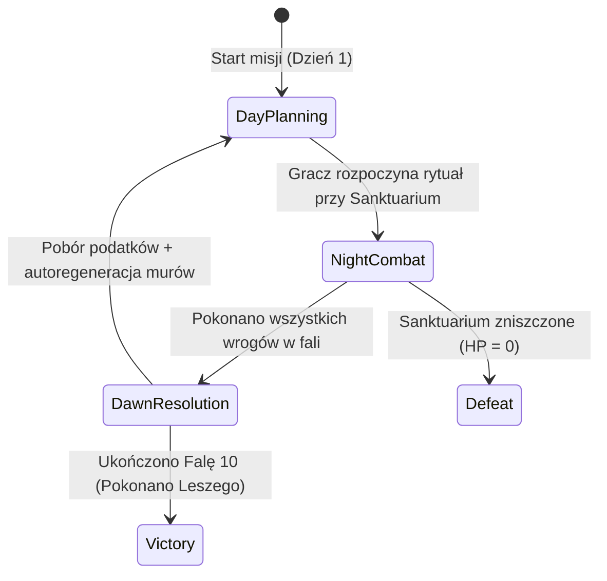
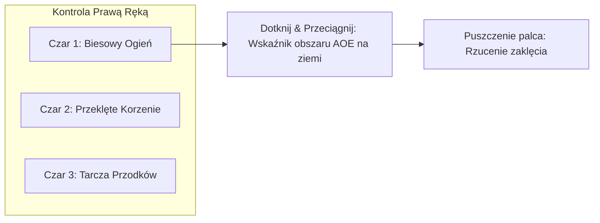
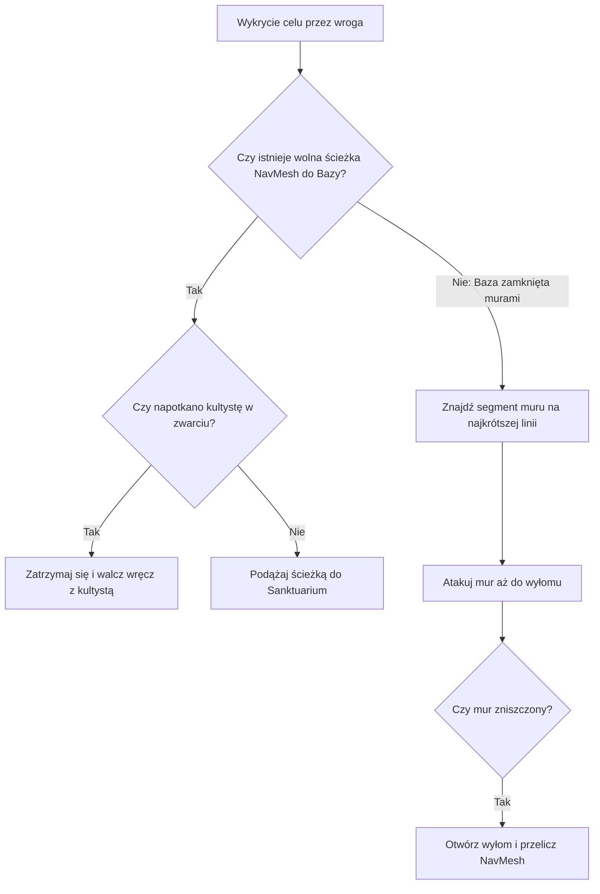

# Game Design Document & Architektura Techniczna: Slavic Witch Tower Defense (Working Title: "Czarcia Straż")

Data: 2026-10-25  
Status: Zatwierdzony do implementacji (Spec Ready)  
Silnik docelowy: Unity 2022.3+ / 2023+ (URP, Mobile Landscape)  
Format rozgrywki: Mobile Tower Defense / Action RTS Hybrid  
Inspiracje: *Thronefall*, *Twierdza (Stronghold)*, *Kingdom Rush: Alliance*, *Cult of the Lamb*, słowiański folklor Podlasia.

---

## 1. Wizja i Filar Rozgrywki (High-Level Pitch)

Gracz wciela się w słowiańską **Wiedźmę**, która zakłada osadę wokół dawnej drewnianej cerkwi przerobionej na okultystyczne sanktuarium. Gra łączy:
1. **Pętlę dnia/nocy i fizyczną budowę z *Thronefall*:** Dzień bez presji czasu, swobodne planowanie fundamentów na siatce, ale fizyczna konieczność dobiegnięcia Wiedźmą do placu budowy i napełnienia go monetami/sianem. Ręczny start nocy.
2. **Budowanie murów i ekonomię populacji z *Twierdzy*:** Swobodne zamykanie przejść murami na siatce, chałupy generujące limit populacji, z którego rekrutuje się kultystów do wież i obrony wręcz.
3. **Aktywne zaklęcia i chokepointy z *Kingdom Rush: Alliance*:** Pasek z loadoutem 3 potężnych czarów na cooldownie oraz kultyści blokujący wrogów na wyznaczonych sztandarach (Rally Points).
4. **Mroczno-przerysowany styl *Cult of the Lamb*:** Groteskowy słowiański kult, soczysty feedback wizualno-dźwiękowy, animacje montażu budynków w stylu klocków/elementów z projektu `AssembleApp`.

---

## 2. Pętla Gry i Maszyna Stanów (Game Loop & Flow)

Rozgrywka w ramach poziomu opiera się na 4-stanowej maszynie stanów (`GameFlowManager`):



### 2.1. Faza Dnia (`DayPlanning`)
* **Spokój i planowanie:** Gracz może swobodnie analizować planszę i planować obronę.
* **Telegrafowanie fali:** Na skraju mapy świecą totemy ze wskaźnikami:
  * Kierunek ataku (północ, wschód, las).
  * Skład fali (ikony jednostek i ich przybliżona liczba).
* **Fundamenty i budowa:** Gracz stawia fundamenty z menu, a potem biega Wiedźmą, aby je sfinalizować.
* **Start Rytuału:** Podejście do Sanktuarium (Bazy) i przytrzymanie przycisku zmierzchu rozpoczyna noc.

### 2.2. Faza Nocy (`NightCombat`)
* Zmiana oświetlenia na klimatyczny, fioletowo-granatowy zmierzch z mgłą i ciepłym światłem pochodni.
* Wrogowie spawnowani są w odstępach ze znaczników.
* Wiedźma porusza się wirtualnym joystickiem, auto-atakuje magią i rzuca 3 aktywne czary.
* Kultyści trzymają wyznaczone wąskie gardła (chokepoints).
* Z każdego zabitego wroga wypada moneta/siano, przyciągana magnetycznie do Wiedźmy.

### 2.3. Faza Świtu (`DawnResolution`)
* Płynne rozjaśnienie sceny w ciepłe złoto-rdzawe barwy poranka.
* **Ekonomia o poranku:** Chałupy mieszkalne generują czynsz w sianie ($+2$ za każdą całą chałupę).
* **Autoregeneracja budynków:** Wzorem *Thronefall*, zniszczone mury i uszkodzone budynki nie przepadają na zawsze – odbudowują się automatycznie z $50\%$ punktów życia (gracz nie traci trwale zainwestowanego siana, ale płaci za naprawę do $100\%$ ułamkiem ceny).
* **Wyzwalacz Ewolucji Mapy:** Jeśli ukończono falę graniczną (np. Fala 3 lub Fala 6), odpala się cutscenka transformacji terenu.

### 2.4. Warunki Końca Gry
* **Porażka (Defeat):** HP Sanktuarium (Bazy) spada do 0.
* **Śmierć Wiedźmy (Respawn Timer):** Jeśli Wiedźma straci całe HP podczas nocy, zamienia się w widmowy nagrobek z timerem 15 sekund. Po upływie czasu odradza się w Sanktuarium z 70% HP. Wioska musi przetrwać ten czas wyłącznie dzięki murom, wieżom i kultystom.
* **Zwycięstwo (Victory):** Przetrwanie wszystkich 10 fal i pokonanie finałowego Bossa (Leszego) w Akcie 3.

---

## 3. Dynamiczna Ewolucja Mapy (Map Evolution System)

Pole bitwy zmienia się w trakcie meczu, zapobiegając schematycznemu "zabetonowaniu" jednej pozycji:

1. **Fale 1–3 (Akt 1 – Północny Trakt):**
   * Dostępna tylko północna polana. Wrogowie atakują z jednej drogi.
   * **Zdarzenie Ewolucji 1 (Koniec Fali 3):** W animacji/trzęsieniu ziemi rzeka opada / most zostaje zablokowany, ale opada mgła na wschodnich moczarach. Wrogowie od Fali 4 atakują z dwóch stron naraz.
2. **Fale 4–6 (Akt 2 – Moczary i Polana):**
   * Gracz musi podzielić obronę na dwa fronty.
   * **Zdarzenie Ewolucji 2 (Koniec Fali 6):** Przebudzenie Puszczy – potężne drzewa na południu przewracają się, otwierając szerokie, trudne do obrony przejście prosto pod tylne wejście Sanktuarium.
3. **Fale 7–10 (Akt 3 – Wojna Totalna):**
   * Trzy otwarte kierunki natarcia, z których w finałowej fali nadciąga leśna armia Leszego.

*Implementacja techniczna:* Komponent `MapEvolutionTrigger` zawiera referencje do obiektów przeszkód (`GameObject[] obstaclesToDisable`, `GameObject[] obstaclesToEnable`) oraz wywołuje runtime'owe przeliczenie `NavMeshSurface.BuildNavMesh()`.

---

## 4. Siatka i Dwuetapowa Budowa z Animacją AssembleApp

### 4.1. Siatka Świata (Grid System)
* Płaszczyzna XZ, rozmiar komórki: $1.5\text{ m} \times 1.5\text{ m}$.
* Macierz komórek `GridCell[,]`:
  * Flagi komórki: `Empty`, `Occupied`, `ReservedBlueprint`, `BlockedTerrain`.
* Rozmiary budynków:
  * Palisada / Mur: $1 \times 1$
  * Wieża Strażnicza: $2 \times 2$
  * Chałupa Słowiańska: $2 \times 2$
  * Koszary Kultystów (Stodoła): $3 \times 2$
  * Sanktuarium Wiedźmy: $4 \times 4$

### 4.2. Dwuetapowa Budowa (Planowanie $\rightarrow$ Realizacja)
1. **Krok 1 (Menu Budowy & Wolna Kamera):**
   * Wciśnięcie ikony budowy odczepia kamerę od Wiedźmy. Gracz przesuwa widok palcem (pan) i przybliża (pinch).
   * Wybranie budynku wyświetla siatkę i wskaźnik poprawności (zielony/czerwony).
   * Ciągnięcie palcem po linii kafelków stawia ciąg fundamentów muru.
   * Postawienie fundamentu tworzy instancję `BlueprintInstance`. Siano **nie jest** pobierane z konta gracza w tym momencie.
2. **Krok 2 (Fizyczne Napełnianie a la *Thronefall*):**
   * Gracz zamyka menu (kamera wraca do Wiedźmy).
   * Wiedźma podbiega do fundamentu i wchodzi w jego trigger interakcji ($R = 2.5\text{ m}$).
   * Co $0.15\text{ s}$ z portfela Wiedźmy transferowana jest 1 moneta do fundamentu z dźwiękiem brzęku monet i efektem cząsteczkowym wylatującego złotego pyłu.
   * Gracz widzi radialny licznik monet nad fundamentem (np. $3/6$).
   * Możliwość przerwania: odejście Wiedźmy zatrzymuje napełnianie, włożone monety nie przepadają.

### 4.3. Animacja Montażu w Stylu `AssembleApp`
Gdy licznik monet osiągnie $100\%$, skrypt `AssembleBuildingAnimator` odtwarza sekwencję klockowego montażu:
1. **Faza 1 (Fundamenty):** Belki podwaliny i kamienie wbijają się z góry w ziemię z soczystym podbiciem (`Tween.PunchScale` / `EaseOutBounce`). Czas: $0.2\text{ s}$.
2. **Faza 2 (Ściany z Bali):** Ściany wysuwają się wertykalnie z gruntu z lekkim wyprzedzeniem i dymem. Czas: $0.3\text{ s}$.
3. **Faza 3 (Dach i Wieżyczki):** Dach, kopuły lub gont spadają z impetem z wysokości $2\text{ m}$ na konstrukcję. Następuje uderzenie, delikatny wstrząs kamery (`CinemachineImpulse`), uniesienie wiórów i pyłu oraz aktywacja `NavMeshObstacle`.

### 4.4. Autotiling Murów (Bitmasking 4-kierunkowy)
Każdy postawiony mur `WallPiece` sprawdza sąsiadów w komórkach $(x, z+1)$, $(x, z-1)$, $(x+1, z)$, $(x-1, z)$:
* 1 sąsiad $\rightarrow$ Zakończenie / Słupek (Pillar).
* 2 sąsiadów naprzeciwko $\rightarrow$ Prosta palisada (Straight).
* 2 sąsiadów pod kątem $90^\circ$ $\rightarrow$ Narożnik L (Corner).
* 3 sąsiadów $\rightarrow$ Rozwidlenie T (T-Junction).
* 4 sąsiadów $\rightarrow$ Skrzyżowanie (Cross).

---

## 5. Katalog Budynków, Ulepszenia i Ekonomia Populacji

### 5.1. Sanktuarium Wiedźmy (Główna Baza – Cerkiew Słowiańska, $4 \times 4$)
Inspirowana drewnianą wschodnio-polską architekturą sakralną (Puchły, Koterka) w mrocznym stylu kultu (ciemne drewno, fioletowa poświata, runy).
* **Poziom 1:** Prosta cerkiewna chata z pojedynczą cebulastą wieżyczką i gankiem. HP: 1500.
* **Poziom 2 (Koszt: 18 siana):** Dochodzi zdobione skrzydło boczne, druga wieżyczka, dymiący krzywy komin. HP: 3000. Aura zwiększa obrażenia wież w promieniu o $15\%$.
* **Poziom 3 (Koszt: 35 siana):** Monumentalna trójdzielna cerkiew z trzema cebulastymi kopułami, świecącymi runami i talizmanami ochronnymi. HP: 5500. Zdolność bazy: automatyczny promień mrocznej energii rażący wrogów co $3\text{ s}$.

### 5.2. Chałupa Słowiańska (Model `Cottage.fbx` z `AssembleApp`, $2 \times 2$)
* **Rola:** Główny generator populacji osady i drobnego czynszu.
* **Poziom 1 (Koszt: 6 siana):** Podlaska chałupa drewniana. Daje $+4$ do limitu Populacji, generuje $+2$ siana o świcie. HP: 400.
* **Poziom 2 (Koszt: 8 siana):** Rozbudowane poddasze i rzeźbione okiennice. Zwiększa limit Populacji z $+4$ do $+8$, generuje $+4$ siana o świcie. HP: 800.

### 5.3. Koszary Kultystów / Stodoła (`Podlasie_Barn_Puchly_62.fbx`, $3 \times 2$)
* **Wymagania:** Zużywa punkty wolnej populacji z chałup mieszkalnych.
* **Jednostki Kultu Gracza (Różnorodność Armii):**
  1. **Akolici z Kosami (Melee Zealots):** Tani, szybcy wojownicy zwarcia blokujący przejścia w bramie.
  2. **Kościani Łucznicy Kultu (Bone Archers):** Strzelcy w maskach ze zwierzęcych czaszek, strzelający fioletowymi strzałami zza murów lub pomostów.
  3. **Opętani Osiłki (Cult Brutes / Poziom 2):** Potężni kultyści z dwuręcznymi kafarami/młotami ogłuszający wrogów.
* **Poziom 1 (Koszt: 10 siana):** Drewniana stodoła z proporcem kultu. Spawnuje 3 Akolitów z Kosami. Gracz może przestawić Sztandar Zbiórki (Rally Point) na dowolne pole siatki.
* **Poziom 2 (Koszt: 14 siana):** Odblokowuje Kościanych Łuczników oraz Opętanych Osiłków. Kultyści zyskują pancerze ze skór i kości ($+50\%$ HP) oraz broń nasączoną jadem (ataki spowalniają wrogów o $20\%$).

### 5.4. Wieża Strażnicza ($2 \times 2$)
* **Wymagania:** Zużywa 1 punkt wolnej populacji jako obsadę.
* **Poziom 1 (Koszt: 8 siana):** Drewniana wieża z bali. Zasięg: $10\text{ m}$, szybkostrzelność: $1.2\text{ s}$, obrażenia: 25 (magiczne kościane pociski).
* **Rozwidlenie Ulepszeń na Poziomie 2 (Koszt: 12 siana):**
  * *Ścieżka A (Wieża Płomienia Biesowego):* Zadaje obrażenia obszarowe (splash $3\text{ m}$) – idealna przeciw hordom chłopów.
  * *Ścieżka B (Wieża Pomoru):* Strzela bełtami przebijającymi pancerz paladynów i nakłada truciznę zadającą obrażenia rozłożone w czasie (DoT).

### 5.5. Palisada Drewniana z Lampionami Rytualnymi ($1 \times 1$)
* **Koszt:** 1 siano za segment.
* **Statystyki:** HP: 500. Zablokowany ruch lądowy.
* **Mroczne Oświetlenie Okultystyczne:** Co 3 segmenty muru na słupie zamontowany jest fioletowy lampion rytualny lub czaszka z fioletowym płomieniem (`PointLight` w URP o zasięgu 3.5m), rzucająca klimatyczny fioletowy blask i cienie na deski palisady oraz ziemię. Belki mają wyryte ledwo widoczne runy jarzące się w ciemności.
* **Ulepszenie do Palisady Okutej (Koszt: 2 siana za segment):** HP: 1200, odbija $10\%$ obrażeń wręcz z powrotem w atakującego.

---

## 6. Sterowanie Wiedźmą, Auto-Atak i System 3 Czarów

### 6.1. Sterowanie Mobilne (Touch HUD) i Osobowość Wiedźmy
* **Osobowość i Wygląd Wiedźmy:** Mroczna, przebiegła słowiańska wiedźma z szyderczym, obłąkanym uśmieszkiem i jarzącymi się ślepiami (żadnego słodkiego uśmiechu czy infantylizmu). W dłoni sękaty kostur trzaskający fioletowymi wyładowaniami klątwy.
* **Lewy ekran:** Pływający wirtualny joystick (`FloatingJoystick`) – pojawia się w miejscu pierwszego dotknięcia palca. Steruje wektorem prędkości Wiedźmy w przestrzeni izometrycznej.
* **Prawy ekran:**
  * Auto-atak: Wiedźma posiada pole detekcji wrogów ($R = 8\text{ m}$). Najbliższy wrogi cel otrzymuje świecący celownik klątwy. Wiedźma automatycznie wystrzeliwuje pociski mrocznej magii co $0.7\text{ s}$ bez przerywania biegu.
  * **Trzy przyciski czarów:** Duże okrągłe ikony w prawym dolnym rogu z radialnym zegarem odliczania (cooldown).



### 6.2. Mechanika Rzucania Czarów (Cast Controls)
1. **Tap & Drag:** Dotknięcie ikony czaru aktywuje projektor zasięgu na ziemi $\rightarrow$ przeciągnięcie palcem po ekranie przesuwa punkt celowania $\rightarrow$ zwolnienie dotknięcia natychmiast odpala czar w wybranym punkcie.
2. **Szybki Double-Tap:** Dwukrotne szybkie puknięcie w ikonę rzuca zaklęcie natychmiast pod nogi Wiedźmy (self-cast).

### 6.3. Biblioteka Czarów (Loadout 3 Zaklęć z Puli)
Gracz wybiera 3 czary w menu przed rozpoczęciem misji:

| Nazwa Czaru | Typ | Cooldown | Koszt / Ograniczenie | Opis Efektu |
| :--- | :--- | :--- | :--- | :--- |
| **Czarci Płomień** | Ofensywa AOE | 14 s | Brak | Zrzuca płonący głaz biesowy. Zadaje 180 dmg w promieniu 4m i podpala ziemię na 4s (hordy chłopów giną w płomieniach). |
| **Przeklęte Korzenie** | Kontrola Tłumu | 18 s | Brak | Z ziemi wystrzeliwują leśne pnącza w okręgu 5m. Wrogowie zostają unieruchomieni na 4.5s i otrzymują 40 dmg. |
| **Rój Upiorków** | Snajper / Single | 10 s | Brak | Wypuszcza 5 naprowadzanych duchów leśnych, które priorytetyzują wrogich strzelców i niszczycieli murów. |
| **Tarcza Przodków** | Obrona Struktur | 25 s | Brak | Wybrany budynek lub 3 segmenty muru otrzymują złotą barierę niewrażliwości na wszelkie obrażenia przez 6 sekund. |
| **Ślepy Pomór** | Chaos / Debuff | 20 s | Brak | Chmura trującego dymu (promień 6m). Wrogowie tracą widzenie i przez 4s atakują najbliższą jednostkę (w tym swoich sojuszników). |
| **Krwawy Rytuał** | Awaryjny Rytuał | 30 s | Kosztuje 25% HP Wiedźmy | Błyskawicznie leczy Sanktuarium o 300 HP i podwaja szybkostrzelność wszystkich wież na 6 sekund. |

---

## 7. Frakcje Wrogów (3 Akty), Archetypy i Logika AI

### 7.1. Zestawienie Jednostek w 3 Aktach

#### **Akt 1: Pospolite Ruszenie i Rycerstwo (Ludzie)**
* **Chłop z widłami (Swarm):** HP: 60, Prędkość: $3.5\text{ m/s}$, Atak: 10 dmg/s. Idzie w masie, podatny na ataki obszarowe i ogień.
* **Strażnik z pawężą (Piechota):** HP: 200, Prędkość: $2.2\text{ m/s}$. Tarcza redukuje obrażenia od pocisków wież o $50\%$ od frontu.
* **Królewski Kusznik (Ranged):** HP: 90, Zasięg: $9\text{ m}$, Atak: 35 dmg co 2s. Trzyma dystans, celuje w kultystów na murach.
* **Paladyn na Koniu (Elita / Tank):** HP: 850, Prędkość szarży: $5.0\text{ m/s}$. Szarżuje na pozycję kultystów, ogłuszając obrońców na 1.5s i zadając 100 dmg pierwszego uderzenia.

#### **Akt 2: Święta Inkwizycja i Łowcy Czarownic**
* **Inkwizytor z Pochodnią (Siege):** HP: 320, Prędkość: $2.8\text{ m/s}$. Ignoruje walkę wręcz z kultystami – jego celem są drewniane mury. Zadaje $300\%$ obrażeń budynkom drewnianym.
* **Łowca Czarownic (Anti-Witch Sniper):** HP: 140, Zasięg: $12\text{ m}$. Ignoruje bazę – gdy tylko Wiedźma pojawi się w polu widzenia, oddaje snajperski strzał bełtem wyciszającym magię na 3 sekundy.
* **Egzorcysta (Aura Support):** HP: 280, Prędkość: $1.8\text{ m/s}$. Roztacza aurę "Świętego Kręgu" ($R = 6\text{ m}$): sojusznicy wewnątrz są odporni na korzenie i spowolnienia, a okoliczne wieże strzelają o $40\%$ wolniej.
* **Ogar Inkwizycji (Flanker):** HP: 80, Prędkość: $5.5\text{ m/s}$. Błyskawicznie szuka dziur w palisadzie i atakuje chałupy mieszkalne.

#### **Akt 3: Leśne Bóstwa i Pradawne Biesy**
* **Utopiec (Błotny Zarodnik):** HP: 250, Prędkość: $2.0\text{ m/s}$. Pozostawia śluz spowalniający obrońców. Po śmierci eksploduje kwasem raniącym mury.
* **Strzyga (Infiltrator):** HP: 180, Prędkość: $4.2\text{ m/s}$. Posiada zdolność skoku ponad palisadą prosto w głąb osady; poluje na niechronione chałupy.
* **Rogaty Bies (Super-Tank / Żywy Taran):** HP: 3200, Prędkość: $2.0\text{ m/s}$. Ogromny leśny demon. Uderzenie rogami niszczy segment palisady w 2 ciosy i odrzuca kultystów.
* **Leszy (Finałowy Boss Aktu 3):**
  * HP: 8000. Powolny marsz na Sanktuarium.
  * Zdolność 1 (Pętla Korzeni): Wyłącza z walki 2 najbliższe wieże na 8 sekund.
  * Zdolność 2 (Leśny Skowyt): Przyzywa watahę 6 widmowych wilków.

---

### 7.2. Logika Zachowania AI przy Murach i Chokepointach
Aby zapobiec blokowaniu się AI na labiryntach i zamkniętych murach, komponent `EnemyBrain` realizuje hierarchię celów:



* **Priorytety specjalne:**
  * Jednostki oblężnicze (`InquisitorTorch`, `HornedBies`) zawsze wybierają najbliższy mur lub wieżę na swojej drodze, ignorując otwarte okrężne ścieżki.
  * Łowca Czarownic zmienia priorytet na Wiedźmę, gdy ta zbliży się na odległość $< 12\text{ m}$.

---

## 8. Architektura Kodu i Wspólne Kontrakty C#

### 8.1. Kluczowe Interfejsy (`Assets/_Project/Scripts/Core/Contracts/`)

```csharp
namespace SlavicTD.Core
{
    public enum DamageType { Physical, Magic, Fire, Poison, Siege }

    public interface IDamageable
    {
        float CurrentHealth { get; }
        float MaxHealth { get; }
        bool IsAlive { get; }
        Transform TargetTransform { get; }
        void TakeDamage(float amount, DamageType type, UnityEngine.GameObject source);
    }

    public interface IInteractable
    {
        float InteractionRadius { get; }
        bool CanInteract(UnityEngine.GameObject interactor);
        void OnInteractStay(UnityEngine.GameObject interactor, float deltaTime);
    }

    public interface IGridEntity
    {
        UnityEngine.Vector2Int GridOrigin { get; }
        UnityEngine.Vector2Int GridSize { get; }
        void OnPlacedOnGrid(UnityEngine.Vector2Int origin);
        void OnRemovedFromGrid();
    }
}
```

### 8.2. Klasa Bazowa Czarów (`SpellDefinition.cs`)

```csharp
namespace SlavicTD.Spells
{
    using UnityEngine;
    using SlavicTD.Core;

    public abstract class SpellDefinition : ScriptableObject
    {
        [Header("Podstawowe")]
        public string spellName;
        public Sprite icon;
        public float cooldown;
        public float radius;
        public GameObject castVfxPrefab;

        public abstract void Cast(Vector3 targetPosition, GameObject caster);
    }
}
```

### 8.3. Definicja Fali (`WaveData.cs`)

```csharp
namespace SlavicTD.Waves
{
    using System;
    using UnityEngine;

    [Serializable]
    public struct EnemySpawnGroup
    {
        public GameObject enemyPrefab;
        public int count;
        public float interval;
        public int spawnPointIndex; // np. 0: Północ, 1: Wschód, 2: Południe
    }

    [CreateAssetMenu(fileName = "Wave_", menuName = "SlavicTD/WaveData")]
    public class WaveData : ScriptableObject
    {
        public int waveNumber;
        public int actNumber;
        public EnemySpawnGroup[] spawnGroups;
        public bool triggersMapEvolution;
        public string evolutionEventId;
    }
}
```

---

## 9. Potok Assetów z AssembleApp (Modele i Stylistyka)

Modele pobierane z projektu `/Users/pdolinski/AssembleApp/`:
1. `AssembleApp/.../Art/Models/Environment/Cottage/Cottage.fbx` $\rightarrow$ Bazowy model Chałupy Słowiańskiej.
   * *Oczyszczenie:* Usunięcie shaderów dioramowych i masek z-bufferowych, przypisanie prostego materiału URP Lit z płaskimi kolorami drewna, bieli i gontu.
2. `AssembleApp/.../Art/Models/Environment/Cottage/Exterior/FBX/Podlasie_Barn_Puchly_62.fbx` $\rightarrow$ Koszary Kultystów.
3. `Podlasie_Picket_Fence.fbx` oraz `Podlasie_Balas_Fence_Bialowieza.fbx` $\rightarrow$ Palisady i ogrodzenia.
4. `AppleTree_Summer.fbx` $\rightarrow$ Drzewa ozdobne i przeszkody na mapie.

*Kierunek Wizualny:* Stylizowany Low-Poly / Flat Toon w URP. Ostre cienie ze słońca, miękka ambient occlusion, wyraziste fioletowo-złote akcenty magii i ognia.

---

## 10. Podział Zadań dla Agentów (Hackathon Work Packages)

Projekt jest przygotowany tak, aby 5 agentów mogło pracować jednocześnie:

* **Pakiet A (Siatka, Fundamenty i Mury):**
  * `GridManager.cs` (konwersja współrzędnych, macierz zajętości komórek).
  * `BlueprintInstance.cs` (makieta fundamentu, promień interakcji, napełnianie monetami a la *Thronefall*).
  * `WallAutoTile.cs` (łączenie ścian 4-kierunkowe).
* **Pakiet B (Wiedźma, Joystick i 3 Czary):**
  * `FloatingJoystick.cs` & `WitchController.cs` (ruch izometryczny).
  * `WitchAutoAttack.cs` (wyszukiwanie wrogów w $R=8\text{m}$, pocisk magiczny).
  * `SpellCaster.cs` + UI (obsługa 3 slotów, drag-to-aim na Canvasie, instancje czarów *Biesowy Ogień*, *Korzenie*, *Tarcza*).
* **Pakiet C (Ekonomia, Populacja i Animacja Montażu):**
  * `EconomyManager.cs` (siano, przychód o świcie, latające monety z fizyką i przyciąganiem).
  * `PopulationManager.cs` (zliczanie populacji z chałup, rezerwacja dla koszar/wież).
  * `AssembleBuildingAnimator.cs` (animacja upadku belek, wznoszenia ścian i tąpnięcia dachu).
* **Pakiet D (Fale Wrogów, 3 Akty i AI Oblężnicze):**
  * `WaveManager.cs` (czytanie `WaveData` SO, spawnowanie, telegrafowanie kierunków na HUD).
  * `EnemyBrain.cs` (nawigacja NavMesh, przełączanie między Bazą, Murem i Kultystami).
  * Prefaby wrogów: Chłop (Swarm), Łowca Czarownic (Anti-Witch), Inkwizytor (Siege), Bies (Tank), Boss Leszy.
* **Pakiet E (Zarządca Gry, Dynamiczna Mapa i UI):**
  * `GameFlowManager.cs` (maszyna stanów: Dzień $\to$ Noc $\to$ Świt $\to$ Win/Lose).
  * `MapEvolutionTrigger.cs` (otwieranie ścieżek po fali 3 i 6, odświeżanie NavMesha).
  * `BuildDrawerUI.cs` (dolny wysuwany pasek wyboru fundamentów).
